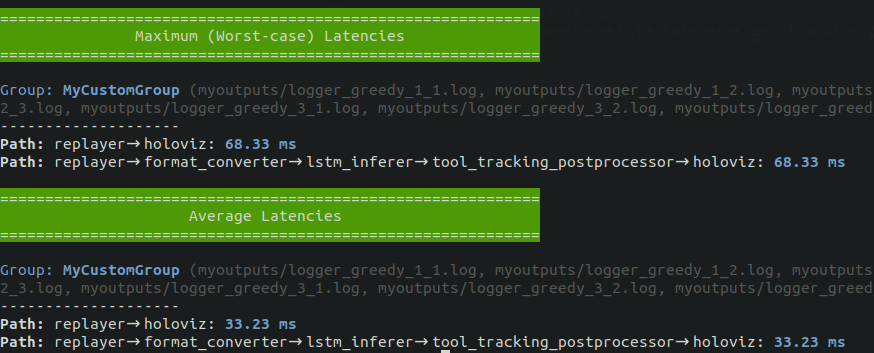
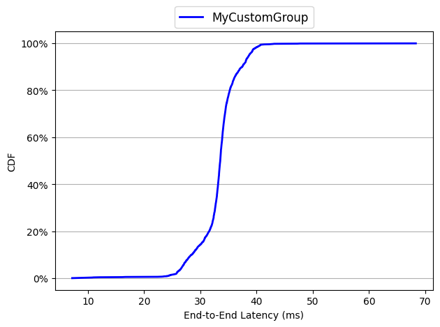
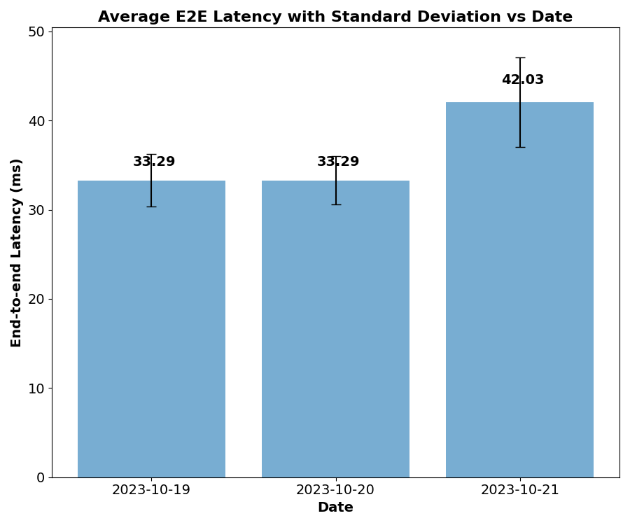
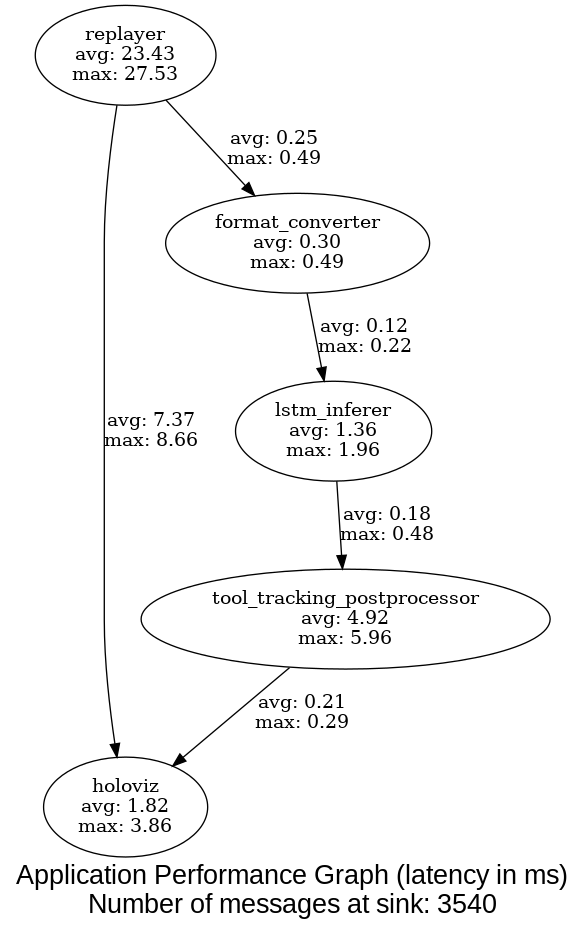

# Holoscan Flow Benchmarking

Holoscan Flow Benchmarking is a comprehensive performance evaluation tool designed to measure and analyze the execution characteristics of HoloHub and Holoscan applications. It provides detailed insights into operator execution times, data transfer latencies, and overall application performance.

For detailed information, refer to:

- [Holoscan Flow Benchmarking Tutorial](./flow_benchmarking_tutorial.md)
- [Holoscan Flow Benchmarking Whitepaper](https://developer.download.nvidia.com/holoscan/Holoscan-Flow-Benchmarking.pdf)

**Key Features:**

- C++ and Python application instrumentation
- Real-time performance monitoring
- Detailed latency analysis
- Visual performance graphs

## Table of Contents

- [Holoscan Flow Benchmarking](#holoscan-flow-benchmarking)
  - [Table of Contents](#table-of-contents)
  - [Benchmark your own application](#benchmark-your-own-application)
  - [Environment Setup](#environment-setup)
    - [Holohub Docker Container (recommended)](#holohub-docker-container-recommended)
    - [Bare-metal Installation](#bare-metal-installation)
  - [Step-by-step Guide to Holoscan Flow Benchmarking](#step-by-step-guide-to-holoscan-flow-benchmarking)
    - [1. Build Applications](#1-build-applications)
      - [Automatic Build with Benchmarking](#automatic-build-with-benchmarking)
      - [Manual Patching \[only if need to\]](#manual-patching-only-if-need-to)
    - [Important notes](#important-notes)
    - [2. Run Benchmarks](#2-run-benchmarks)
    - [3. Analyze Results](#3-analyze-results)
      - [3.1 Basic Analysis](#31-basic-analysis)
      - [3.2 Generate CDF Plot](#32-generate-cdf-plot)
      - [3.3 Historical Analysis](#33-historical-analysis)
  - [Generate Application Graph with Latency Numbers](#generate-application-graph-with-latency-numbers)
    - [Monitor application performance in real-time](#monitor-application-performance-in-real-time)

## Benchmark your own application

Use the application environment in which your Holoscan SDK, models, data, and
other dependencies are already installed. Set the absolute path to this
repository and install the analysis dependencies:

```bash
export HOLOSCAN_BENCHMARKS_ROOT=/absolute/path/to/holoscan-benchmarks
python -m pip install numpy matplotlib
```

The workflow below runs your application directly with the instrumentation
helpers. The `benchmark.py` runner uses HoloHub project metadata, including when
given `--run-command`, and requires `holoscan-cli` and `nvitop`. See
[Environment Setup](#environment-setup) for that workflow and optional graph
visualization dependencies.

### Enable instrumentation

The instrumentation helpers read measurement options from environment variables.
Your application must enable flow tracking to write the logs that the analyzer
reads.

For Python, put the tool directory on the module search path:

```bash
export PYTHONPATH="$HOLOSCAN_BENCHMARKS_ROOT/benchmark_tools/flow_benchmarking${PYTHONPATH:+:$PYTHONPATH}"
```

Then adapt your existing application class, keeping its `compose()` implementation:

```python
from benchmarked_application import BenchmarkedApplication

class MyApplication(BenchmarkedApplication):
    # Keep your existing compose() implementation here.
    ...
```

For C++, include `benchmark.hpp` and derive your application from
`BenchmarkedApplication`. Add
`<repository>/benchmark_tools/flow_benchmarking` to the application's compiler
include directories and rebuild it. See the [C++ helper](benchmark.hpp) and
[Python helper](benchmarked_application.py) for the instrumentation.

These helpers enable flow logging, set the scheduler, and add count conditions
to operators. Review those settings when adapting an application with custom
scheduling or termination conditions. An application that already writes
compatible flow logs can also use the analysis tools directly.

### Run and analyze

From the application's normal working directory, collect a flow log:

```bash
mkdir -p benchmark-output
HOLOSCAN_NUM_SOURCE_MESSAGES=1000 \
HOLOSCAN_SCHEDULER=greedy \
HOLOSCAN_FLOW_TRACKING_LOG_FILE="$PWD/benchmark-output/flow.log" \
    python3 /absolute/path/to/my_application.py
```

After the application completes successfully, analyze its log:

```bash
python "$HOLOSCAN_BENCHMARKS_ROOT/benchmark_tools/flow_benchmarking/analyze.py" \
    -g benchmark-output/flow.log MyApplication \
    --avg --max --median --percentile 95 99
```

For C++, replace the Python command with your built executable and its arguments.
Repeat the run with distinct log filenames to collect multiple trials, then
pass those files together after `-g`. Record the scheduler and other settings
for each trial, and verify application logs as well as the reported results.
The analyzer discards the first and last ten samples of each path in each input
log before calculating statistics.

For an individual operator, build a small test application with controlled inputs
and the connections needed to exercise it. Use flow analysis for pipeline timing
and `app_perf_graph.py` for timings derived from operator and connection
timestamps. The existing [thread scheduling](../../benchmarks/realtime_threads_benchmarking/README.md)
and [green context](../../benchmarks/green_context_benchmarking/README.md)
benchmarks demonstrate specialized measurements with their own instrumentation.

## Environment Setup

The runner examples below use C++ applications in a separate HoloHub checkout.
Run `./holohub` commands from that checkout; they use HoloHub's launcher and build integration.
Set `HOLOSCAN_BENCHMARKS_ROOT` to the absolute path of this repository in each
shell. When using a container, make this repository available inside it and set
the path there.

For Python applications in a separate checkout, follow the
[direct instrumentation workflow](#benchmark-your-own-application) and instrument
the file you actually execute. The runner's automatic Python patching assumes
the tools and HoloHub build tree share a repository root; it may patch source
files while the launcher runs an uninstrumented copy from the build directory.

### Holohub Docker Container (recommended)

All dependencies are automatically managed by the Holohub Docker container. You can simply run:

```bash
./holohub run-container <application_name> --extra-scripts benchmarking
```

> [!NOTE]
> This command sets up the benchmarking environment on top of the default Holohub container image, unless you specify an application with a custom Dockerfile. In that case, the benchmarking environment attempts to extend the application's Dockerfile. However, this process hasn't been fully tested for every possible custom Dockerfile, and success depends on how the Dockerfile is authored. Some Dockerfiles may already include the required benchmarking support and may work even without the `--extra-scripts benchmarking` option; in other cases, there may be conflicts or additional manual steps needed. Always refer to the relevant application's README for any application-specific benchmarking instructions or compatibility considerations.

### Bare-metal Installation

If not using the Holohub Docker container, apart from the holoscan and application's specific dependencies, additional Python packages should be installed:

```bash
pip install holoscan-cli
pip install -r "$HOLOSCAN_BENCHMARKS_ROOT/benchmark_tools/flow_benchmarking/requirements.txt"
```

`holoscan-cli` provides the project metadata APIs that `benchmark.py` uses to
resolve applications and modes; see
[holoscan-cli](https://github.com/nvidia-holoscan/holoscan-cli) for pinning or
pre-release specs.

These python dependencies include:

- numpy: Data processing
- matplotlib: Graph generation
- nvitop: GPU monitoring
- pydot: Graph creation
- xdot: Graph visualization

**Note:** `xdot` has additional system dependencies. See [xdot requirements](https://github.com/jrfonseca/xdot.py?tab=readme-ov-file#requirements).

## Step-by-step Guide to Holoscan Flow Benchmarking

### 1. Build Applications

#### Automatic Build with Benchmarking

```bash
./holohub build <application_name> [options] --benchmark
```

This command:

- Patches the application source
- Builds with benchmarking enabled
- Automatically restores source files after build

For example:

```bash
./holohub build endoscopy_tool_tracking --benchmark --language cpp
```

#### Manual Patching [only if need to]

```bash
# Apply patches
"$HOLOSCAN_BENCHMARKS_ROOT/benchmark_tools/flow_benchmarking/patch_application.sh" <app_directory>

# Example: Patch endoscopy tool tracking
"$HOLOSCAN_BENCHMARKS_ROOT/benchmark_tools/flow_benchmarking/patch_application.sh" applications/endoscopy_tool_tracking

# Restore original files when done
"$HOLOSCAN_BENCHMARKS_ROOT/benchmark_tools/flow_benchmarking/restore_application.sh" <app_directory>
```

**Note:** Source files are backed up as `*.bak` during patching. A manually
patched C++ application also needs the tool directory on its compiler include
path so it can find `benchmark.hpp`.

### Important notes

- Verify the application runs correctly after building and before proceeding with performance evaluation.
  For example, run the app `./holohub run endoscopy_tool_tracking --language cpp` (append `--local` if you are using the bare-metal installation)
- For applications using TensorRT, run once to generate engine files (e.g., for the endoscopy tool tracking application).
- See [patch_application.sh](./patch_application.sh) and [restore_application.sh](./restore_application.sh) for more details about the patching process.

### 2. Run Benchmarks

```bash
python "$HOLOSCAN_BENCHMARKS_ROOT/benchmark_tools/flow_benchmarking/benchmark.py" -a <app_name> [options]
```

**Key Options:**

- `-a, --holohub-application`: Application name
- `-r, --runs`: Number of runs
- `-i, --instances`: Instances per run
- `-m, --num_messages`: Number of frames to process
- `--sched`: Scheduler type
- `-d, --log-directory`: Output directory
- `--run-command`: Custom run command (if needed)
- `-u, --monitor_gpu`: Monitor GPU utilization (discrete GPU only)

For a complete list of arguments, run:

```bash
python "$HOLOSCAN_BENCHMARKS_ROOT/benchmark_tools/flow_benchmarking/benchmark.py" -h
```

**Example:**

```bash
# Run endoscopy tool tracking benchmark
python "$HOLOSCAN_BENCHMARKS_ROOT/benchmark_tools/flow_benchmarking/benchmark.py" \
    -a endoscopy_tool_tracking \
    -r 3 -i 3 -m 200 \
    --sched greedy \
    -d myoutputs
```

**Output Files:**

- Data flow logs: `logger_<scheduler>_<run>_<instance>.log`
- GPU utilization: `gpu_utilization_<scheduler>_<run>.csv`

### 3. Analyze Results

#### 3.1 Basic Analysis

```bash
python "$HOLOSCAN_BENCHMARKS_ROOT/benchmark_tools/flow_benchmarking/analyze.py" \
    -g myoutputs/logger_greedy_* MyCustomGroup \
    -m -a  # Show max and average latencies
```



#### 3.2 Generate CDF Plot

```bash
python "$HOLOSCAN_BENCHMARKS_ROOT/benchmark_tools/flow_benchmarking/analyze.py" \
    --draw-cdf single_path_cdf.png \
    -g myoutputs/logger_greedy_* MyCustomGroup \
    --no-display-graphs
```



#### 3.3 Historical Analysis

```bash
python "$HOLOSCAN_BENCHMARKS_ROOT/benchmark_tools/flow_benchmarking/bar_plot_avg_datewise.py" \
    avg_values_2023-10-{19,20,21}.csv \
    stddev_values_2023-10-{19,20,21}.csv
```



## Generate Application Graph with Latency Numbers

The app_perf_graph.py script can be used to generate a graph of a Holoscan application with latency data from benchmarking embedded into the graph. The graph looks like the figure below, where graph nodes are operators along with their average and maximum execution times, and edges represent connection between operators along with the average and maximum data transfer latencies.



### Monitor application performance in real-time

```bash
# Terminal 1: Run benchmark
python3 "$HOLOSCAN_BENCHMARKS_ROOT/benchmark_tools/flow_benchmarking/benchmark.py" \
    -a endoscopy_tool_tracking \
    -i 1 -r 3 -m 1000 \
    --sched=greedy \
    -d endoscopy_results

# Terminal 2: Generate live graph
python3 "$HOLOSCAN_BENCHMARKS_ROOT/benchmark_tools/flow_benchmarking/app_perf_graph.py" \
    -o live_app_graph.dot \
    -l endoscopy_results

# Terminal 3: View live graph
xdot live_app_graph.dot
```
